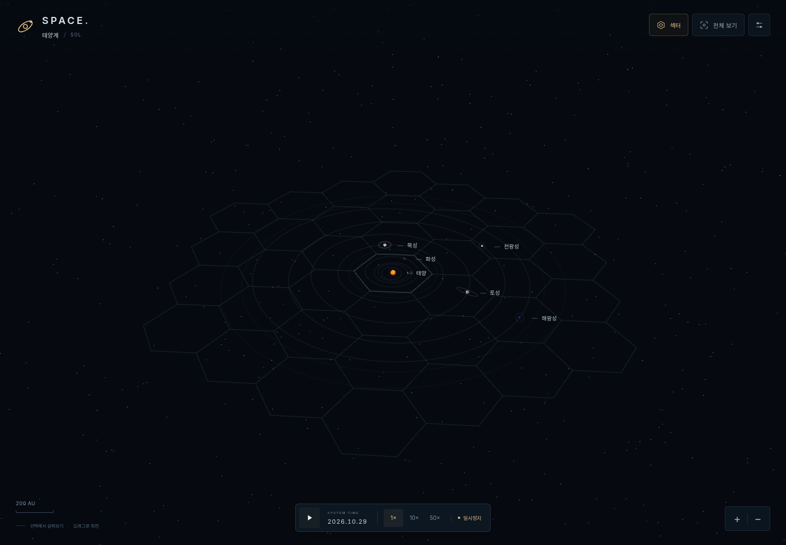
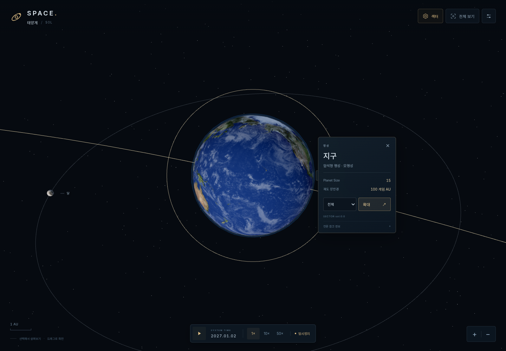
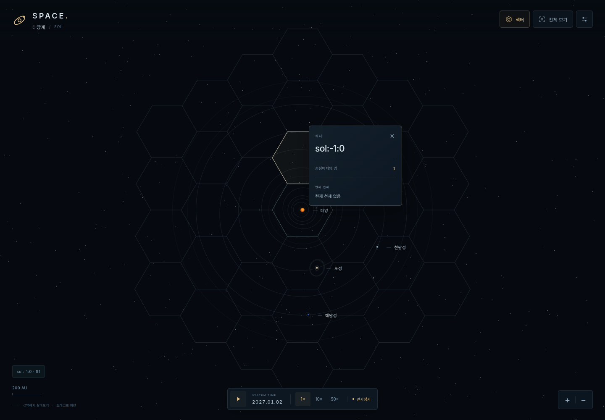
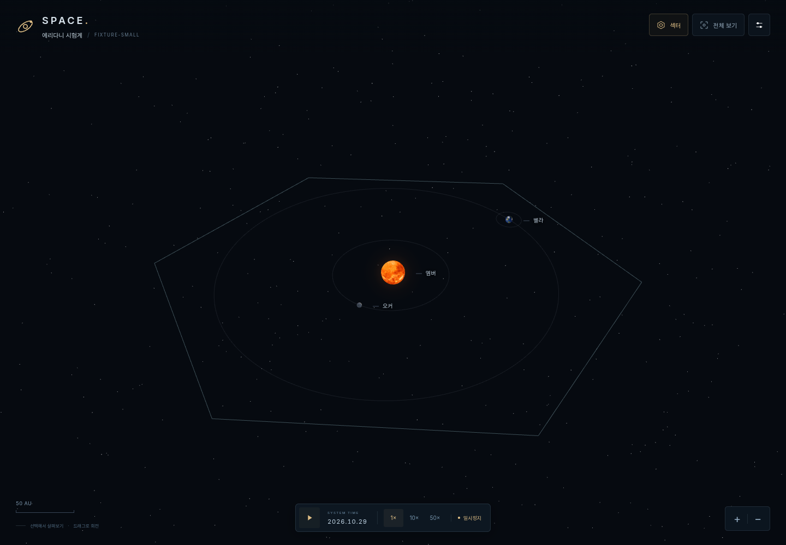
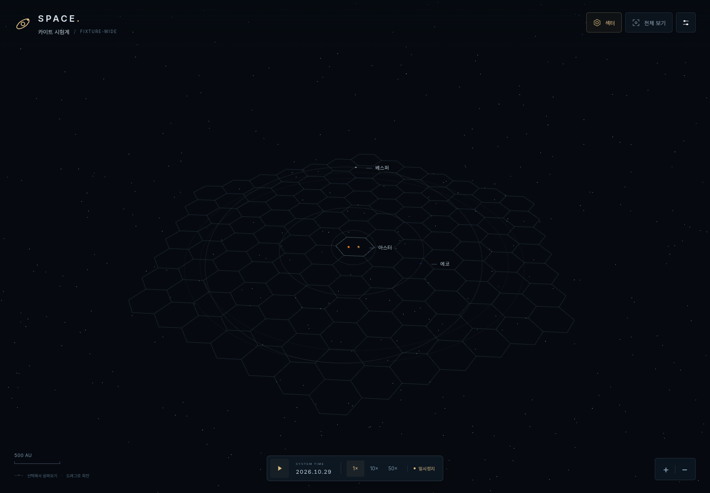
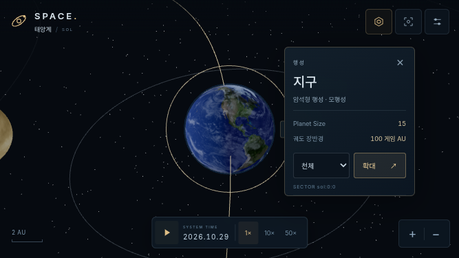

# v0.4 — 공용 항성계 UI와 고정 육각 섹터

작업일: 2026-10-30. [사용자 통합 지시서](REQUEST_KO.md)에 따른 Phase 0 개편입니다.

## 기준과 제출 관계

- 저장소: `0-FLANDRE-0/SPACE_Project`.
- 기준: v0.3 거리 추가 조정까지 검증된 `6bfd7d87ad412b4957fd523633f78eeb83b4d009`.
- 작업 브랜치: `feat/v0.4-universal-ui-hex-sectors`.
- v0.3 [PR #1](https://github.com/0-FLANDRE-0/SPACE_Project/pull/1)이 미병합이므로 새 PR은 `feat/v0.3-game-au-size-system`을 대상으로 하는 후속 PR입니다. 선행 PR 병합 후 base를 main으로 바꿀 수 있습니다. main 병합과 기존 라이브 사이트 변경은 수행하지 않았습니다.

## 실제 변경

| 파일 | 변경 |
|---|---|
| `dist/src/system-context.js` | 활성 컨텍스트, 태양계 어댑터/기존 설정 검증, 임의 평면·좌표·범위 산정 |
| `dist/src/fixtures/systems.js` | 작은 K형·큰 이동/경사/다중 항성 시험계 |
| `dist/src/hex-sectors.js` | 순수 axial 계산, 최소 링, 정확한 커버 범위, 결정적 조회·성장 |
| `dist/src/sector-view.js` | 배치 렌더링, 평면 레이 교차, 호버·선택·줌 감쇠·정리 |
| `dist/src/context-panel.js` | kind별 소형 탭, 확대 명령, 공전/카메라 추적·화면 경계 대응 |
| `dist/src/scene.js` | 컨텍스트 주입, 데이터 기반 카메라·렌더링·다중 항성 조명, 선택 우선순위와 수명주기 |
| `dist/src/main.js`, `dist/index.html`, `dist/style.css` | 최소 HUD, 숨겨진 설정, 개발 전환 UI, 모바일 가로 배치 |
| `dist/src/model.js` | 선택/궤도 강조 map 주입과 컨텍스트 리셋; 궤도·자전 수식 유지 |
| `dist/src/textures.js` | 표면 파일 목록을 인자로 받을 수 있도록 확장 |
| `tests/hex-sectors.test.js`, `tests/browser-smoke.mjs` | 순수 기하/컨텍스트·실제 브라우저 흐름 검증 |
| `scripts/check-syntax.mjs`, `package.json` | 중첩 모듈까지 문법 검사, 0.4.0 |
| README, DECISIONS, VERIFICATION, 이 문서 | 최종 동작·결정·검증 기록 |

상시 목록/오른쪽 관측 패널을 교체했습니다. 천체 선택만으로는 줌하지 않습니다. 정보 탭의 `확대`를 누르면 부드럽게 접근하여 공전을 추적합니다. 천체/주변 궤도 범위를 선택할 수 있습니다. 다른 천체 선택은 새 탭을 열고, 닫기·Esc·그리드 밖 빈 공간은 해제합니다. 그리드 내부 빈 공간은 섹터를 선택합니다.

## 공통 크기·최소 링·커버 범위

`HEX_SECTOR_RADIUS_GAME_AU = 210`은 **중심에서 꼭짓점까지의 반경**이며 변 길이도 210입니다. 내접원 반경은 약 181.865 AU, 인접 중심 거리는 약 363.731 AU입니다. 모든 시스템에서 동일한 전역 상수 하나를 사용합니다. 게임 AU→월드 환산은 기존 `gameAUToWorld()`만 사용합니다.

| 시스템 | 원래 범위 반경 AU | 10% 여유 포함 AU | 최소 링 | 총 칸 | 실제 격자가 완전히 덮는 원의 반경 AU |
|---|---:|---:|---:|---:|---:|
| 태양계 `sol` | 900.000 | 990.000 | 3 | 37 | 1,050.000 |
| 작은 시험계 `fixture-small` | 163.1725 | 179.48975 | 0 | 1 | 181.8653 |
| 큰 시험계 `fixture-wide` | 1,811.1803 | 1,992.2984 | 6 | 127 | 2,003.2723 |

범위는 모든 행성의 원일점, 위성의 부모 궤도 포함 포락선, 고리·표시 반지름, 영역 외곽, 명시적 범위, 섹터 원점과 시스템/궤도 중심의 오프셋을 포함합니다. 순간 위치만으로 결정하지 않습니다. 구형/방사상 포락선이므로 기울어진 궤도에도 보수적인 범위입니다.

실제 생성한 육각형 집합의 **노출 경계 선분 전체**에 대해 원점과의 최소 거리를 계산합니다. 오목한 경계까지 포함하므로 그 거리 이하의 원 전체가 합집합 안에 있습니다. 2링의 보장 반경은 `sqrt(13) × 210 ≈ 757.166`으로 990을 덮지 못하고, 3링은 1,050으로 덮습니다. 세 시스템 모두 이전 링이 부족함을 확인했고, 각 범위에서 1,440개 방향 × 3개 반경의 추가 수치 검사도 통과했습니다.

## 좌표와 확장 계약

- Pointy-top axial `(q,r)`, 링 거리는 `max(|q|, |r|, |q+r|)`.
- ID `systemId:q:r`. 같은 로컬 좌표라도 시스템이 다르면 다른 ID입니다. 천체 ID는 컨텍스트 map 안에서 범위를 보장하며 외부 저장용 `scopedBodyId()`를 제공합니다.
- 경계 동률: 안쪽 링 → q 오름차순 → r 오름차순. 같은 점은 같은 칸을 반환합니다.
- 기준 평면은 origin/normal/tangentU로 정의하고 정규 직교 기저를 만듭니다. 3D 위치의 고도는 소속 섹터 조회에 영향을 주지 않으며 실제 위치는 바뀌지 않습니다.
- 큰 시험계는 시스템 중심 `(3200,500,-1600)`, 섹터 원점 `(3210,505,-1600)`, 법선 입력 `(0.35,0.82,0.45)`입니다. 첫 항성도 중심에서 벗어납니다. 두 항성과 세 행성, 외곽 영역이 같은 공용 코드로 동작합니다.
- `growHexGrid()`는 기존 반경·링을 유지하고 필요한 외곽 링을 추가합니다. 기존 ID·중심·경계는 불변입니다. 새 천체 발견/저장 시스템 자체는 구현하지 않았습니다.
- 섹터는 고정되어 있고 현재 천체 소속은 `gamePositionToSector()`로 매번 조회합니다. 목성이 공전 중 다른 섹터로 넘어가는 테스트가 있습니다.

## 기존 규칙과 자료 보존

`data.js`, `game-space.js`, `astronomy-data.js`, `selection.js`, `validation.js`와 기존 모델/천문 참고 테스트는 기준 커밋과 같습니다. `model.js`의 천체력·IAU 수식도 그대로입니다.

- 1 게임 AU = 140/53 월드 단위, 수성 표시 53 AU/배치 장반경 140 월드 단위.
- 행성 장반경: 53 / 79 / 100 / 142 / 280 / 420 / 570 / 730 게임 AU.
- Planet Size: 9 / 15 / 15 / 11 / 50 / 45 / 30 / 29, 고정 월드 지름.
- 태양 G2V, Star Size 90 → 월드 지름 70. 지구 반지름 7.5, 태양 반지름 35 월드 단위 유지.
- 대표 위성 11개, 부모 공전 추적, 타원·경사·방향·위상·시간 배속, 실제 참고 좌표, 표면 지도·구름·고리 유지.

참고 km/실제 AU를 게임 거리와 혼합하지 않습니다. 팝업의 `천문 참고 정보`는 선택적으로 펼칩니다. 모든 지도 눈금은 게임 AU입니다. 새 실제 천문 수치를 추가하거나 NASA/JPL 원본을 수정하지 않았습니다. 기존 태양계 시작 시 궤도 여유 검증도 Sol 어댑터에 유지합니다. 보조 기준 평면은 숨겨진 설정에서 켤 수 있으며 활성 항성계의 원점·경사를 사용합니다.

## 렌더링과 수명주기

공통 경계는 중복 변을 제거한 LineSegments 하나입니다. 중앙·호버·선택 경계는 공용 Geometry를 사용하고, 선택 면만 따로 표시합니다. 깊이 검사를 적용하고 근접에서는 희미해져 지구/위성 표면 위로 선이 과도하게 겹치지 않게 합니다. 숨김/근접 시에도 논리 조회는 유효합니다.

입력은 DOM → 실제 구체 → 화면 보조 → 섹터 순서입니다. 이동 5px 초과 드래그와 다중 터치, 평행한 레이는 선택하지 않습니다. 섹터 클릭마다 그리드를 재생성하지 않습니다.

전환 시 컨텍스트 이벤트를 AbortController로 중단하고 Geometry/Material/소유 광채 Texture·라벨을 정리합니다. 공유 표면 텍스처와 renderer는 전환 중 재사용하고 뷰어/페이지 종료 때 해제합니다. 브라우저에서 이전 Geometry dispose 이벤트, 라벨 분리, canvas 1개, 반복 전환 후 GPU Geometry 수, 최종 canvas/라벨 제거를 검사합니다.

## 검증·스크린샷·한계

최종 자동/브라우저 결과와 캡처 목록은 [검증 기록](../VERIFICATION.md)에 기록합니다. 캡처는 실제 Chromium 렌더링이며 개발 도구로 도형을 합성하지 않았습니다.

실제 모바일 GPU·Safari/Firefox·장기 메모리 안정성은 별도 실기기 검증이 필요합니다. 시험계는 가상 자료이며 쌍성 역학·자원·함선·건설·연구·안개·저장은 구현하지 않았습니다. 전체보기의 작은 천체는 물리 크기를 유지하므로 라벨·선택 보조 또는 안쪽 영역/근접 보기를 사용합니다. 큰 격자를 임의 규모로 무한 확장하는 부하 검증은 하지 않았습니다.

## 스크린샷

| 보기 | 실제 Chromium 캡처 |
|---|---|
| 초기 전체보기·37칸 | [전체보기](screenshots/overview.png) |
| 천체 선택만 한 정보 탭 | [목성 선택](screenshots/body-tab.png) |
| 안쪽 영역·공전 추적 탭 | [안쪽 영역](screenshots/inner.png), [공전 후 지구 탭](screenshots/moving-tab.png) |
| 지구·달·목성·토성 근접 | [지구](screenshots/earth-close.png), [달](screenshots/moon-close.png), [목성](screenshots/jupiter-close.png), [토성](screenshots/saturn-close.png) |
| 소행성대 선택·강조 | [소행성대](screenshots/belt-close.png) |
| 섹터 선택·가장자리 탭 | [섹터 정보](screenshots/sector-selected.png), [가장자리 배치](screenshots/edge-tab.png) |
| 작은 시험계·공용 정보 탭 | [1칸 전체보기](screenshots/small-system.png), [벨라 근접](screenshots/small-context.png) |
| 큰 시험계·127칸·경사 평면 | [전체보기](screenshots/wide-system.png), [상부 섹터 선택](screenshots/wide-sector.png) |
| 모바일 844×390 | [전체](screenshots/mobile-844-overview.png), [천체 탭](screenshots/mobile-844-context.png), [섹터](screenshots/mobile-844-sector.png), [달 터치 선택](screenshots/mobile-844-moon.png) |
| 모바일 667×375 | [전체](screenshots/mobile-667-overview.png), [천체 탭](screenshots/mobile-667-context.png), [섹터](screenshots/mobile-667-sector.png), [달 터치 선택](screenshots/mobile-667-moon.png) |

### 전체보기

### 천체 옆 탭과 확대

### 섹터 선택

### 다른 크기의 항성계

### 모바일 가로

