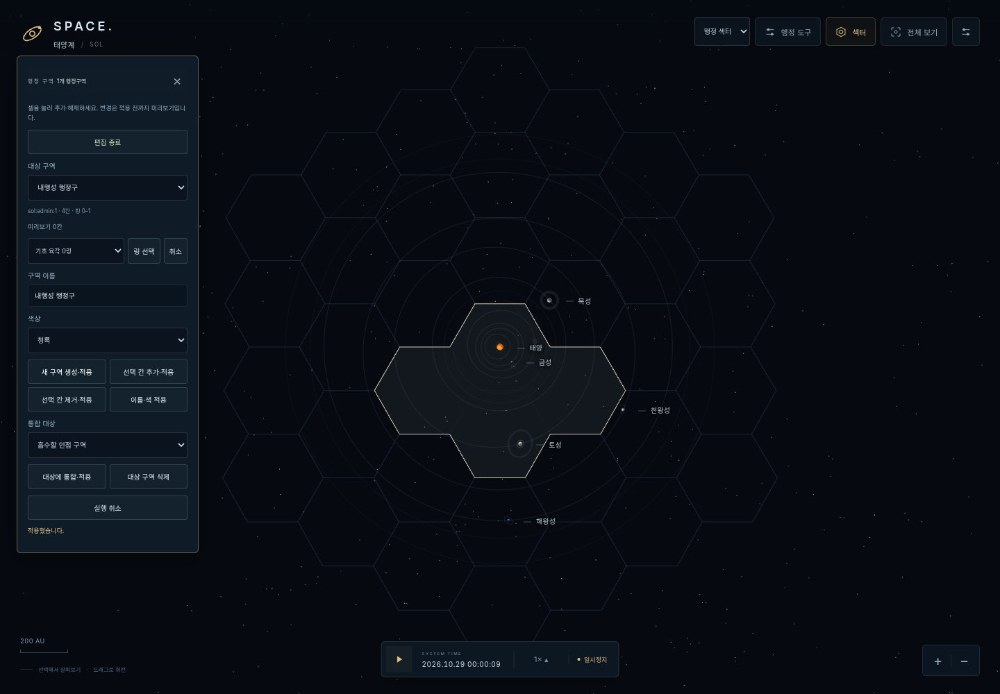
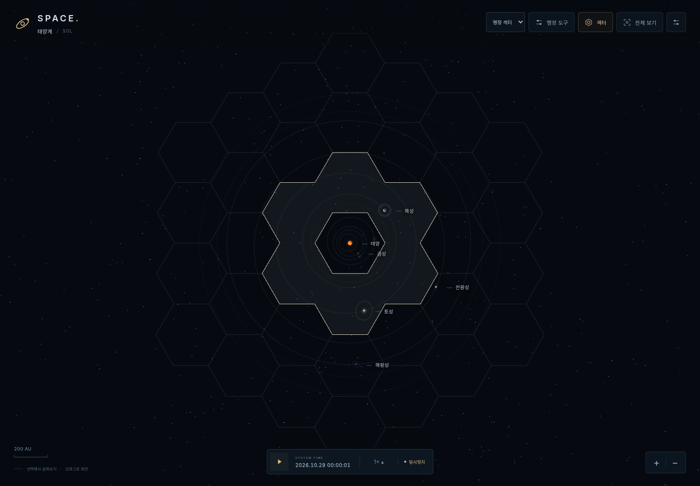
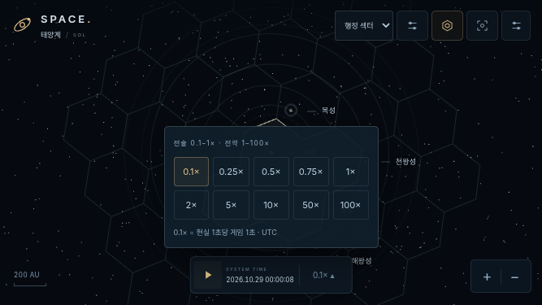

# v0.5A — 행정구역과 정확한 시간 제어

작업일: 2026-10-30 (사용자 기준 Asia/Seoul). 게임 월드 시계는 UTC입니다. [작업 지시서](REQUEST_KO.md)의 행정 편집·시간 개편 범위를 구현하고, 사용자가 별도로 요청한 실행 링크와 HTML ZIP을 제공합니다.

## 기준과 제출

v0.4 `b303764d1a8699baa34e6ba8d030d30c475e6591`에서 `feat/v0.5-admin-regions-time-control`을 만들었습니다. 선행 [PR #2](https://github.com/0-FLANDRE-0/SPACE_Project/pull/2)가 미병합이므로 PR base는 `feat/v0.4-universal-ui-hex-sectors`입니다. v0.3 [PR #1](https://github.com/0-FLANDRE-0/SPACE_Project/pull/1) → v0.4 → 이 PR 순서로 검토합니다. GitHub main은 수정·병합하지 않습니다.

기존 Sites의 사용자 접근 범위를 유지하여 검증된 작업 브랜치 코드를 별도 Sites 소스 저장소로 배포합니다. 이것은 SPACE_Project main 병합이 아닙니다. [실행](https://space-project-sol-prototype.dagoku.chatgpt.site) · [HTML ZIP](https://space-project-sol-prototype.dagoku.chatgpt.site/downloads/SPACE_Project_v0.5A_HTML.zip).

## 구현 파일

| 파일 | 책임 |
|---|---|
| `administrative-regions.js` | 공유 변 연결성, 생성/추가/제거/통합/이름·색/삭제/Undo, 안정 ID, 버전 JSON 검증·격리·백업 |
| `administrative-region-view.js` | 내부/외곽/미지정 경계 분류, 중복 없는 배치 표현, 구멍 경계, 면 색상, 선택·미리보기 |
| `administrative-region-ui.js` | 탐사/행정 모드, 보기/편집 상태, 명시적 적용, 링 선택, 오류·복구 UI |
| `time-control.js` | 10:1 기본 환산, 배속 프리셋/상한, 전경 시간 기준, UTC 형식 |
| `model.js`, `data.js` | 단일 Simulation 시계 연결, 과거 0.02일/초 상수 교체. 천체력 공식 유지 |
| `sector-view.js`, `scene.js`, `context-panel.js` | 기존 그리드에 행정 레이어 연결, 편집 중만 셀 우선, 현재 위치 행정구 표시 |
| `main.js`, HTML/CSS | 작은 지도 모드·행정 도구·속도 메뉴, 프레임 시계 교정, 모바일 스크롤 드로어 |
| `tests/administrative-regions.test.js`, `time-control.test.js`, `browser-administration.mjs` | 새 모델·시간·실제 편집/터치/저장 검증 |
| `tests/browser-smoke.mjs` | 기존 v0.4 시나리오 유지, 속도 메뉴 접근 경로만 새 UI에 맞춤 |
| `scripts/package-release.py` | 현재 커밋의 HTML/자산/로컬 서버 ZIP과 배포 tar 생성 |

## 화면 흐름

탐사 섹터는 v0.4 기본 경계선을 그대로 보여줍니다. 행정 섹터에서 도구를 열면 처음에는 **보기 상태**입니다. `셀 편집 시작`을 누르면 같은 셀을 클릭/터치하여 미리보기 선택을 추가·해제합니다. 이름·색을 정하고 `새 구역 생성·적용`으로 확정합니다. 대상 구역을 골라 추가/제거/이름·색 변경/인접 구역 흡수/삭제를 적용할 수 있습니다. 실행 취소는 최근 20개를 시스템별로 유지합니다.

이미 할당된 칸을 링 선택하면 그 수를 알리고, 생성/추가 시 충돌을 거부합니다. 자동으로 다른 구역의 셀을 빼앗지 않습니다. 링 선택은 기초 육각 링이며 실제 행성 궤도가 아닙니다. 1링 6칸으로 가운데 빈 구멍을 가진 구역을 만들 수 있습니다. 연결이 끊어지는 제거/비인접 합병은 원상태를 유지하고 이유를 표시합니다.

보기에서는 DOM → 천체 메시 → 천체 보조 → 셀, 편집 중에는 DOM → 셀 순서입니다. 따라서 태양과 겹친 중앙 셀도 편집 가능합니다. 5px 이상 드래그 및 다중 터치는 선택하지 않습니다. 카메라 회전·핀치·줌은 유지합니다. 드로어는 시간창 위에서 높이가 제한되고 내부 스크롤/닫기를 제공합니다.

## 경계·좌표·수명주기

기초 좌표 함수와 **210 게임 AU** 반경은 변경하지 않았습니다. 태양계 **3링/37칸**, 작은 시험계 **0링/1칸**, 큰 시험계 **6링/127칸**입니다. 행정구역은 기초 ID만 참조하므로 원래 셀 중심·크기·이웃·고도는 바뀌지 않습니다.

행정 모드에서는 중앙 셀의 별도 기본 강조선도 숨겨 통합된 내부 변을 진하게 덮지 않습니다. 지도 모드 전환은 천체 선택과 카메라를 유지합니다.

공유 변을 한 번만 열거하여 같은 비어 있지 않은 구역 ID는 내부선, 다른 구역/미지정과의 접점은 외곽선, 양쪽 미지정은 기초 경계로 분류합니다. `null === null`을 구역으로 보지 않습니다. 구멍의 안쪽 변도 외곽입니다. 초기 알파는 내부 0.028 < 기본 0.17 < 외곽 0.55, 선택 0.85, 구역 면 0.075입니다. 면은 셀별 삼각형을 한 배치로 그려 빈 중심을 채우지 않습니다.

구역 편집·메타데이터 변경/전환 때만 경계와 색 면을 재생성합니다. 호버나 매 프레임에는 만들지 않습니다. 미리보기와 선택 외곽은 별도 경량 Geometry만 바꿉니다. 임의 평면의 기존 부모 transform·깊이 검사·줌 페이드를 사용합니다. 이전 Geometry/Material은 교체 시 dispose하며 UI 이벤트는 단일 AbortController로 정리합니다.

`currentSectorId`는 현재 위치, 향후 `administrativeRegionId`는 고정 행정 소속입니다. 이번 UI의 행정 표시는 **현재 위치의 구역**이며 고정 소속을 부여하는 기능이 아닙니다. 행성 공전으로 고정 소속을 자동 변경하지 않습니다. 행정구역이 행성 재고를 복제하지도 않습니다.

## 저장 계약

`localStorage['space-project:administration:v1']`은 `{schemaVersion:1, systems:{systemId:{regions,nextRegionSerial}}}`입니다. 각 region은 `id/systemId/name/color/sectorIds`를 가집니다. ID는 `systemId:admin:serial`, 이름 변경·합병 후 대상 ID는 유지하며 Undo 후에도 일련번호를 되감지 않습니다. 새 기초 링은 미지정으로 추가됩니다.

편집은 복사본에 적용한 뒤 전체 검증을 통과해야 반영·저장합니다. 시스템 ID, 셀 존재, 중복 할당, 연결성, 이름·팔레트·일련번호를 검사합니다. 잘못된 JSON/버전은 덮어쓰지 않으며, 잘못된 시스템 상태는 그 시스템만 격리합니다. 복구 버튼은 **원본 전체를 `:backup` 키에 먼저 보존한 뒤** 초기화합니다. 저장 실패는 현재 탭 메모리에만 편집을 남기고 알립니다. 다른 도메인/포트/브라우저의 저장소는 별개입니다.

시간·선택·POP·경제·오프라인 경과는 저장하지 않습니다.

## 시간 규칙과 정확성

`gameSeconds = realSeconds × 10 × effectiveSpeed`, `Simulation.days += gameSeconds / 86400`.

| UI 배속 | 현실 1초당 게임 초 |
|---:|---:|
| 0.1× / 0.25× / 0.5× / 0.75× | 1 / 2.5 / 5 / 7.5 |
| 1× | 10 |
| 2× / 5× / 10× / 50× / 100× | 20 / 50 / 100 / 500 / 1,000 |

requestedSpeed·effectiveSpeed·speedCap·paused를 분리했습니다. `setSpeedCap(1)`은 요청 100×를 보존한 채 1×로 제한하고, 해제하면 요청 100×로 복원합니다. 실제 위험 탐지는 없습니다. 미래 위험 진입 기본 0.1× 정책은 후속 컨트롤러가 구현할 계약입니다.

정상 전경 프레임 지연은 시계에 전부 반영합니다. 0.1초 제한은 렌더 보간에만 남겼습니다. 일시정지/배속을 바꿀 때 이전 정책으로 경과 시간을 먼저 반영합니다. visibility 전환 때 기준 시각을 갱신하므로 숨김 경과를 복귀 때 적용하지 않습니다. 60초 이상 대기 간격은 서스펜션으로 간주하여 건너뛰고 알립니다. 시간 표시는 `YYYY.MM.DD HH:mm:ss`, UTC입니다. 새로고침은 1×입니다.

NASA/JPL·게임 AU 140/53·행성 크기·공전/자전 수식·11개 위성·지도·고리는 유지합니다. 기존 시간 테스트도 삭제하지 않았고 새 숫자 계약을 별도 테스트로 추가했습니다.

## 실행과 미구현

ZIP 압축 해제 후 `python3 serve.py` 또는 `py serve.py`로 실행합니다. HTML/스크립트/로컬 Three.js/지도/라이선스를 포함하며, 패키지의 SOURCE.json에 커밋을 기록합니다. 직접 file:// 실행은 ES 모듈 제약으로 지원하지 않습니다.

미구현: 함선·전투·건설·인구·경제·정책·연구·안개·전체 게임 저장·오프라인 정산. 미래 `1 POP=100만`, 오프라인 1.25×(현실 12.5배), 최대 게임 60일은 문서만 있고 실제 진행·보상은 없습니다. 실기기 GPU/Safari/Firefox/장기 부하는 미검증입니다.

자동 검사와 실제 PC/모바일 캡처는 [검증 기록](../VERIFICATION.md)을 참고하세요.

## 실제 캡처

| 흐름 | 캡처 |
|---|---|
| 기초 지도 / 4칸 편집 / 행정 표시 / 기초 복구 | [기초](screenshots/exploration-before.png), [4칸 편집](screenshots/four-cell-edit.png), [행정](screenshots/administration-after.png), [기초 복구](screenshots/exploration-restored.png) |
| 구멍과 경사 평면 | [고리 구역](screenshots/ring-with-hole.png), [경사 시험계](screenshots/tilted-administration.png) |
| PC 시간 메뉴 | [시간 제어](screenshots/time-controls.png) |
| 844×390 | [편집](screenshots/mobile-844-editor.png), [행정 지도](screenshots/mobile-844-administration.png), [시간](screenshots/mobile-844-time.png) |
| 667×375 | [편집](screenshots/mobile-667-editor.png), [행정 지도](screenshots/mobile-667-administration.png), [시간](screenshots/mobile-667-time.png) |

항성계 보기 전환은 세계 시계의 days를 되감지 않습니다. 월드 UTC epoch를 고정하고 선택 네임스페이스만 바꿉니다. v0.4의 전환 시 days=0 기대값은 이번 단일 세계 시계 계약에 맞게 수정했으며 해당 테스트를 유지했습니다.
