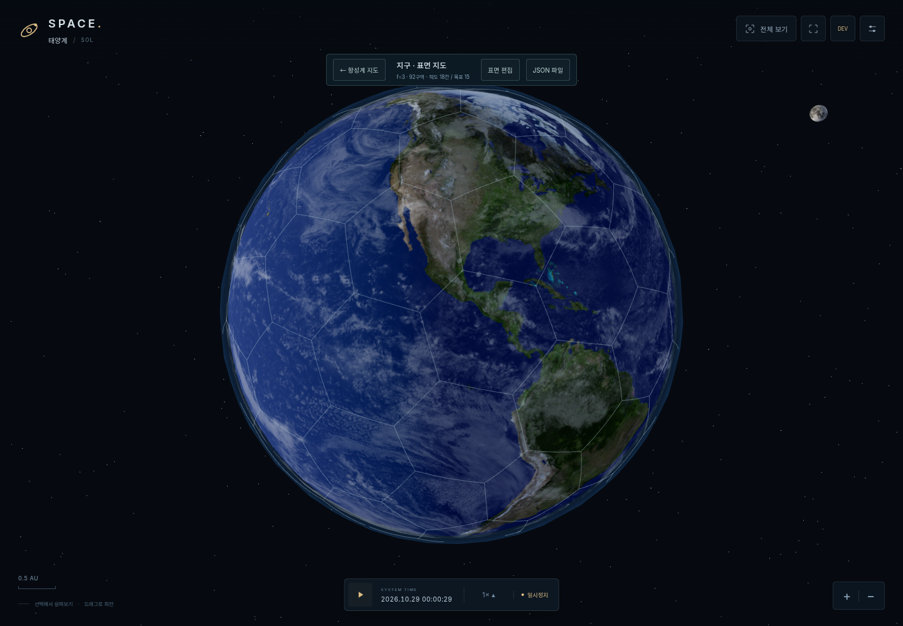
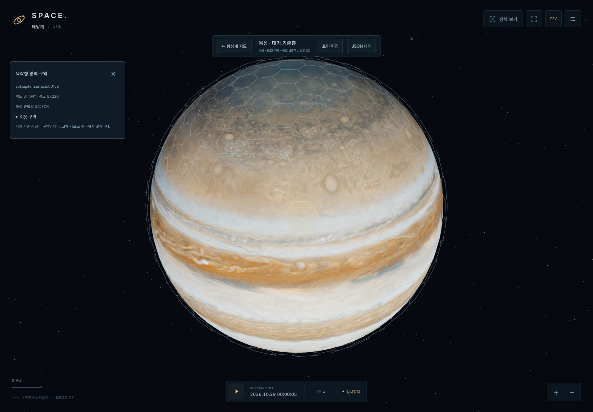
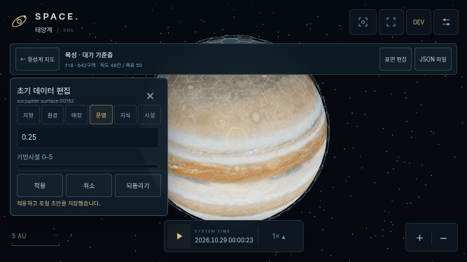

# v0.5B — 모든 행성·위성 표면 지도와 공용 편집기

작업 기준일: 2026-10-31 (Asia/Seoul). [작업 지시서](REQUEST_KO.md)를 구현하며 이전에 요청된 실행 링크와 HTML ZIP도 갱신합니다.

## 선행 관계

기준 v0.5A `15359f0cf4ef888caf020c1e5f34df166710cfc3`, 새 브랜치 `feat/v0.5b-planetary-surface-editor`. 미병합 [PR #3](https://github.com/0-FLANDRE-0/SPACE_Project/pull/3)을 base로 새 PR을 제출합니다. PR #1 → #2 → #3의 선행 관계를 유지하며 main 수정·병합·리베이스·강제 푸시는 수행하지 않습니다. 기존 사이트의 동일 접근 범위를 유지하는 별도 Sites 배포는 GitHub main 병합과 구분합니다.

## 구현 구조

| 모듈 | 책임 |
|---|---|
| `planetary-surface-grid.js` | DOM/Three.js 없는 결정적 정이십면체 세분화·구면 Voronoi dual·정확한 다각형 조회 |
| `planetary-surface-model.js` | 원본 지질/환경·2100 초기 시나리오·미설정·U/POP·공용 스키마 검증 |
| `planetary-surface-io.js` | 중복 키를 거부하는 JSON 파싱, 원자적 가져오기, 시스템/천체별 초안·백업, 정적 프리셋 |
| `planetary-surface-view.js` | spin에 붙는 배치 경계·앞면 셰이더·일치하는 구면 레이 선택·선택 면·정리 |
| `planetary-surface-ui.js` | 공용 표면 보기/복귀, 읽기 전용 정보, 개발자 편집·Undo·파일 미리보기/적용 |
| `resource-definitions.js` | 1 U=10톤, 1 POP=100만 명, ore/alloy/C 분리와 전략 자원 레지스트리 |
| `developer-mode.js` | 단일 devEnabled 상태, 5초 안 7회 로고 탭, 키보드·취소·종료·드로어 |
| `fullscreen-control.js` | 실제 API 상태 기반 버튼, Esc, 실패/미지원/권한 제한 안내 |
| 기존 scene/main/context-panel/HTML/CSS | 기존 입력의 표면 모드 연결, 전체화면과 도구 배치 |
| `dist/data/planet-surfaces/` | 검증된 내보내기 JSON을 게임 초기 데이터로 등록하는 manifest 경로 |

기존 항성계의 210 AU 육각형과 행정구역, 게임 AU 140/53 환산, Size, 천문 epoch, 공전/IAU 자전, 지도·구름·고리, 시간 0.1–100×는 유지합니다. 표면 선택은 별도 로컬 좌표계이며 공간 행정 소속을 변경하지 않습니다.

## 격자와 해상도

정이십면체의 각 면을 정수 주파수 f로 분할한 뒤 단위 구에 투영합니다. 원 삼각형의 구면 외심을 dual 꼭짓점으로 사용합니다. 셀은 원 정점을 중심으로 한 구면 Voronoi 다각형이며 12개 오각형과 나머지 육각형입니다. 총 셀 수 `10f²+2`, dual 꼭짓점 `20f²`, 변 `30f²`, Euler 값 2입니다. 면적은 구면 삼각형으로 계산하고 합계는 4π입니다.

정확한 각 셀의 반공간 경계로 조회합니다. 최근접 중심만으로 클릭을 대신하지 않습니다. 같은 다각형의 great-circle 변을 렌더링하고 클릭도 같은 구면/경계에서 판별합니다. 경계 동률은 최소 셀 인덱스입니다. 뒷면·접선·구 내부 카메라 원점은 선택하지 않습니다. 경도 seam이나 극지방에서 위경도 격자 보정을 하지 않습니다.

`generatorVersion=1`, `orientationId=body-local-v1`을 고정합니다. 결정적 조합 키를 바이트 순서로 정렬해 인덱스를 부여하며 ID는 `{encodedSystemId}:{encodedBodyId}:surface:{5자리 index}`입니다. 예약 문자를 인코딩하여 시스템/천체 ID 조합 충돌을 막습니다. 좌표·면적·이웃·방향·대상에서 안정 FNV-1a checksum을 계산합니다. 보안 인증용 해시가 아닙니다. 버전/f/방향/fingerprint가 다르면 마이그레이션 없이 적용하지 않습니다.

지원 f=2–12에서 실제 적도와 경계의 모든 교차점을 구하고 사이 구간을 조회하여 적도 통과 셀 수를 측정합니다. 목표와 차이가 최소인 f를 선택하고 동률은 낮은 f를 택합니다. Planet Size 15→f=3은 몸체 ID와 무관한 버전 1 보호 캘리브레이션입니다. 위성은 표시 지름으로 목표를 구하고 최소 f=2를 사용합니다. 명시적인 `surfaceResolutionOverride`도 검증합니다. 상한을 넘는 목표는 개발자 UI에 알립니다.

| 태양계 천체 | f | 총 셀 | 실제 적도 통과 |
|---|---:|---:|---:|
| 수성 | 2 | 42 | 12 |
| 금성 | 3 | 92 | 18 |
| 지구 | 3 | 92 | 18 |
| 화성 | 2 | 42 | 12 |
| 목성 | 8 | 642 | 48 |
| 토성 | 7 | 492 | 42 |
| 천왕성 | 5 | 252 | 30 |
| 해왕성 | 5 | 252 | 30 |
| 달·포보스·데이모스·이오·유로파·가니메데·칼리스토·타이탄·엔셀라두스·티타니아·트리톤 | 각각 2 | 각각 42 | 각각 12 |

지구의 적도 18칸은 실제 계산 결과이며 목표 15를 맞추려고 모양을 늘리거나 f를 소수로 만들지 않았습니다. 목성/토성도 92칸으로 강제하지 않습니다. 위성 지름·행성 크기는 격자 때문에 바뀌지 않습니다. 모든 개발 시험계 행성·위성도 같은 정책입니다.

## 화면과 선택

천체 선택만으로 줌하지 않습니다. 모든 planet/moon 정보 탭의 `표면 지도` 버튼을 눌러 진입합니다. 기존 `확대`는 그대로입니다. 항성·소행성대에는 표면 버튼이 없습니다.

활성 천체 하나의 spin에 경계 LineSegments와 선택선/선택 면만 붙입니다. 기본 구체·표면 지도·구름·대기·고리를 교체하지 않습니다. 얇은 레이어 반경 1.025는 Z-fighting을 피하기 위한 오버레이 높이이며 Planet Size/물리 반경을 바꾸는 값이 아닙니다. 선택 레이도 같은 반경을 사용합니다. 가까울 때만 표시하고 뒷면은 깊이 검사와 몸체 로컬 법선 셰이더로 가립니다. 선택 면은 구면으로 세분화해 지표 아래로 파묻히지 않게 합니다.

표면 모드 입력은 DOM → 앞면 표면 다각형 → 해제이며 항성계 평면/행정 편집을 호출하지 않습니다. 표면 진입 시 행정 편집을 종료합니다. 복귀하면 이전 공간 지도 모드·표시·카메라/추적을 가능한 한 복원합니다. 다른 천체·시스템 선택/H 전체보기에서도 정리합니다. 한 번의 셀 선택은 카메라를 점프시키지 않습니다.

위도는 로컬 +Y 북극, 경도는 +X 기준·-Z 동향으로 기존 SphereGeometry 텍스처 좌표에 맞춥니다. 격자는 텍스처와 같은 spin에 고정되어 자전·공전 후에도 ID와 지리 좌표가 유지됩니다.

## 원본/시나리오/런타임 분리

표면 JSON은 schemaVersion 1의 `planet-surface-template`이며 대상 ID와 grid 정의, `geology.cells`, `startingScenario`를 가집니다. 두 cells는 sparse override입니다. 미설정 타일은 모두 조회 가능하고 인구·도시화·환경·매장지는 null입니다. 사용자가 0 또는 빈 배열을 명시한 경우와 구분합니다.

- 지질: surfaceType, 지형 카탈로그, 육지/물 비율, 온도/방사선/장애/거주 적합성/대기 메모, 자연 매장지.
- 가스/얼음 거대행성: 고체 지표가 아닌 atmosphere 기준층. 육지/물 비율을 강요하지 않고 null을 유지합니다. 부유 시설 등의 가능성은 메타데이터만 편집합니다.
- 매장지: depositId/resourceId/initialReserveU, 선택적 난도·발견 단계·메모. 1 U=10톤, 0.01 U=100kg. ore 지원, alloy/크레딧은 자연 매장 불가. 전략 자원은 레지스트리에 추가할 수 있습니다. 수치 안전 한도는 매장지 1e12 U입니다(최종 밸런스 아님).
- 2100 시나리오: 정수 populationPersons(최대 1e12), 0–1 도시화, 0–5 기반시설, 문명/통치/점유 ID, 문명별 초기 knowledge, 셀 안의 시설 id/typeId/notes. POP 입력은 정수 인구로 정확히 변환합니다. 별도 총인구를 저장하지 않고 입력 셀의 합계를 계산하며 미설정 셀을 구분합니다.
- 2100은 메타데이터입니다. 실제 천문 epoch나 단일 세계 시계를 2100으로 옮기지 않습니다. 인구 성장·생산·채굴·건설·탐사 작업·전투를 실행하지 않습니다.
- 미래 runtime은 별도 스키마입니다. remainingReserveU, 진행 인구, 작업 누적량, 실제 점유/피해를 원본에 덮어쓰지 않습니다. 초기 knowledge와 실제 지질 매장량도 별개입니다. 현재 위치의 항성계 행정 섹터를 통치 세력으로 자동 복사하지 않습니다.

## 편집·파일·저장

개발자 모드에서 앞면 타일을 고르면 지형/환경/매장/문명/지식/시설 탭을 편집합니다. 적용 전에는 템플릿을 바꾸지 않습니다. 검증 실패는 전체 거부, 취소는 입력 복원, Undo는 마지막 성공 적용을 되돌립니다. 일반 보기에서는 기하 정보만 보여주며 실제 미발견 매장량·파일·편집 폼을 노출하지 않습니다. 개발자 종료 시 폼과 비공개 입력 DOM도 비웁니다.

JSON은 `<input type=file>`과 Blob 다운로드를 사용합니다. 읽기 → 대상·버전·격자·값·중복 키/ID 검증 → 미리보기 → 명시적 덮어쓰기 확인 → 적용 순서입니다. 현재 초안 백업 내보내기도 제공합니다. 최대 5 MiB/깊이 32, 매장지/시설 배열 수를 제한합니다. 알 수 없는 자원·음수·NaN/Infinity·비정상 큰 수·중복/없는 셀·다른 천체·다른 fingerprint·runtime 필드를 거부합니다.

초안 키는 `space-project:surface:v1:{encodedSystem}:{encodedBody}`로 행정 저장소와 분리합니다. 저장 실패/손상/구버전은 원본을 보존하고 메모리 편집과 JSON 백업을 안내합니다. 명시적 가져오기 덮어쓰기에서는 이전 원본을 `:backup`에 먼저 보존합니다. [정적 프리셋 경로](../../dist/data/planet-surfaces/README.md)에 내보낸 파일과 manifest를 추가하면 다른 브라우저에서도 같은 초기 상태를 읽습니다. 현재 manifest는 비어 있어 예시 인구/자원은 기본값으로 배포하지 않습니다.

## 개발자 진입과 전체화면

SPACE 로고를 5초 안에 7회 클릭/탭하면 개발자 모드와 도구가 열립니다. 한 번 클릭·지도 드래그는 활성화하지 않습니다. 키보드로 로고를 포커스하고 Enter로 반복 활성화할 수도 있습니다. 명시적 종료/재진입과 `?dev=1` 호환을 제공하며 새 탭 기본값은 비활성입니다. 임계치는 단일 상수입니다. 숨김 동작은 인증이 아니고 서버·타인 데이터에 쓰는 기능이 없습니다.

전체화면은 일반 HUD에 항상 있습니다. 사용자 클릭 안에서 표준 API를 호출하며 실제 fullscreenElement와 이벤트로 상태를 갱신합니다. Esc/버튼 종료 시 선택·입력·카메라를 유지합니다. API 미지원·Promise 거부·iframe 정책 제한은 안내하고 실패를 성공으로 표시하지 않습니다. 주소창 숨김 흉내나 강제 방향 고정은 없습니다. ResizeObserver와 safe-area/100dvh를 사용합니다. 실제 iPhone/Safari의 전체화면 성공을 보증하지 않습니다.

## 실행 결과와 한계

[검증 기록](VERIFICATION.md)에 자동 검사, 브라우저·파일·전체화면 실동작, 모든 19개 천체 렌더 결과, 캡처와 한계를 기록합니다. 함선·경제·채굴·인구 성장·전투·탐사 타이머·오프라인 정산·복잡한 다중 셀 일괄 편집은 구현하지 않았습니다.

## 실제 렌더 캡처

| 보기 | 캡처 |
|---|---|
| 지구·편집·JSON | [표면](screenshots/earth-surface.png), [편집](screenshots/earth-editor.png), [가져오기](screenshots/json-import.png) |
| 다른 천체 | [화성](screenshots/mars-surface.png), [목성](screenshots/jupiter-surface.png), [토성](screenshots/saturn-surface.png), [달](screenshots/moon-surface.png), [시험계](screenshots/fixture-surface.png) |
| PC 전체화면 | [실제 전체화면](screenshots/fullscreen.png) |
| 844×390 | [개발자](screenshots/mobile-844-developer.png), [지구](screenshots/mobile-844-earth.png), [화성](screenshots/mobile-844-mars.png), [목성](screenshots/mobile-844-jupiter.png), [달](screenshots/mobile-844-moon.png), [전체화면](screenshots/mobile-844-fullscreen.png) |
| 667×375 | [개발자](screenshots/mobile-667-developer.png), [지구](screenshots/mobile-667-earth.png), [화성](screenshots/mobile-667-mars.png), [목성](screenshots/mobile-667-jupiter.png), [달](screenshots/mobile-667-moon.png), [전체화면](screenshots/mobile-667-fullscreen.png) |

## 산출물

[실행 사이트](https://space-project-sol-prototype.dagoku.chatgpt.site) · [HTML ZIP](https://space-project-sol-prototype.dagoku.chatgpt.site/downloads/SPACE_Project_v0.5B_HTML.zip). 최종 배포 결과는 PR과 완료 응답에서 확인합니다. [미설정 JSON 예제](EMPTY_TEMPLATE_EXAMPLE.json)는 스키마 확인용이며 게임 기본 manifest에 등록하지 않았습니다.
