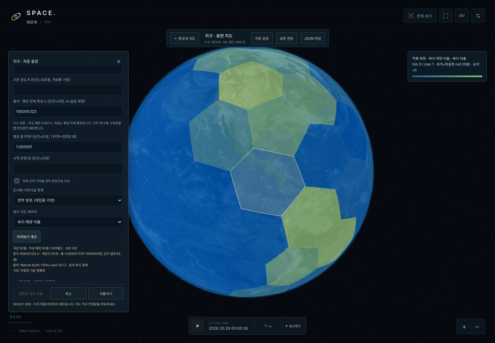
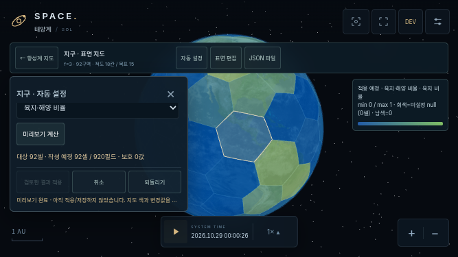

# v0.5C 검증 기록

2026-10-31 (Asia/Seoul), v0.5B `25695aa` 기반. [구조·완료 보고](REVIEW.md), [지구 원천/라이선스/한계](../../dist/data/planetary-generation/README.md), [미래 runtime 계약](../architecture/TERRAFORMING_DATA_CONTRACT.md).

## 자동 검사

- `npm run check`: **33개 소스 모듈** 문법 검사.
- `npm test`: **99개 통과, 실패/건너뜀0**. 기존76개 그대로 + 신규23개.
- 신규 테스트는 결정성/호출순서/시간·random 비의존, 시드·프로필 차이, 모든19개/두 fixture의 격자 보존, 대표 실지구 좌표·면적/극/경도 seam/오각형, 연속 지형, null/0/육해 쌍·대기층, 환경 범위·미정 값, 0.001 U/정수 인구/최대값 총량 보존, 자원 등록·가스 ore 거부, 고유 광맥 ID·미발견 지식, 수동값/빈 배열/1명/시설 보존, 선택 밖 고정값 차감·중복 방지·초과 거부, 명시적 정착 중심, 자연·문명 독립 필드, preview/실패 원본 불변, SurfaceDrafts commit/Undo, 다른 대상/fingerprint·knowledge 참조 거부, v1 왕복·sidecar 분리, 6개 검수 모드의 null/0 구별, 전체 항성계별 실패/취소, 미래 현재값 합성 시 원본 불변을 확인합니다.
- `git diff --check`, Python 패키저/자료 가공기 문법 검사. 기존 격자/천문/시간/210 AU/크기 핵심 파일은 v0.5B와 동일합니다.

## 실제 브라우저

Chromium + Playwright, SwiftShader 소프트웨어 렌더링. PC1440×1000, 터치 에뮬레이션844×390/667×375. 정적 서버 → 모듈 Worker → 로컬 원천 → 미리보기 → 확인 → SurfaceDrafts → localStorage/다운로드/업로드/새로고침의 전체 흐름을 검사합니다.

| 스크립트 | 실제 검사 |
|---|---|
| [기존 지도](browser-smoke.log) | 천체/위성 선택·가림·정보 탭·카메라·궤도·고정 크기·210 AU·fixture·터치/핀치·GPU 정리 |
| [기존 행정/시간](browser-administration.log) | 실제 편집/Undo/연결 거부/저장·0.1×/1×/100× 실제 시계·두 모바일 |
| [기존 표면](browser-surface.log) | 모든19개 실제 표면 렌더/앞면 선택·오각형·수동 편집·v1 파일·자전 고정·격자/geometry정리·PC/두 모바일 native Fullscreen·Esc·거부/미지원/iframe |
| [새 자동 설정](browser-generation.log) | 실제 숨김 진입/Worker/미리보기 불변/정확한 총량/6개지도/색 geometry 재사용/적용·Undo/수동0·1명·404K·[]보존/v1·sidecar 다운로드·업로드·reload/예산 초과 거부/화성·달·목성·fixture/100× 시계/개발자 종료 정리/두 모바일 실제 터치 확인·적용·전체화면 |
| [안전 경로](browser-safety.log) | 실제 복수선택·행성 전체 잔여 예산·명시적 교체 파일/로컬 백업·preview 이후 변경 원본 거부·worker 닫기/시스템 취소·quota 실패 메모리 유지 |

검사별 최종 PASS와 오류 유무는 연결된 원본 실행 로그에 기록합니다. 실기기 iPhone/Safari/Firefox 및 OS 파일 선택기 자체는 미검증입니다. 파일 입력/Blob 다운로드와 실제 브라우저 네이티브 전체화면은 Chromium에서 확인했습니다.

## 실제 화면

- PC: [지구 육해·출처](screenshots/earth-land-preview.png), [광석](screenshots/earth-ore-preview.png), [화성 인구](screenshots/mars-preview.png), [달](screenshots/moon-preview.png), [목성 대기층](screenshots/jupiter-preview.png), [시험계](screenshots/fixture-preview.png).
- 844×390: [지구](screenshots/mobile-844-earth-land.png), [화성](screenshots/mobile-844-mars.png), [달](screenshots/mobile-844-moon.png), [목성](screenshots/mobile-844-jupiter.png).
- 667×375: [지구](screenshots/mobile-667-earth-land.png), [화성](screenshots/mobile-667-mars.png), [달](screenshots/mobile-667-moon.png), [목성](screenshots/mobile-667-jupiter.png).





가로667 화면에서도 생성 폼 내부 스크롤과 적용/취소/Undo footer가 하단 HUD 위에 있으며 전체화면 버튼 접근을 확인했습니다. 작은 화면에서 모든 입력을 동시에 표시하지는 않습니다.

## 성능·저장 한계

[19개 공용 코어 측정](generation-performance.json)은 Node 단일 실행이며 GPU/모바일 벤치마크가 아닙니다.

| 대상 | 셀 | 생성 | 병합·검증 |
|---|---:|---:|---:|
| 지구 |92|약3.7ms|약4.6ms|
| 목성 |642|약12.7ms|약31.9ms|
| 토성 |492|약8.4ms|약27.1ms|

브라우저에서는 생성/병합을 Worker에서 수행하며 입력 변경은 이전 preview를 무효화합니다. 색상 레이어는 활성 천체 하나의 Mesh1개, 지구8,640/목성61,440 삼각형을 추가하고 모드 전환 시 위치 geometry를 재사용합니다. 셀별 Mesh/DOM 또는 매프레임 재생성은 없습니다. 반복 열기/계산/모드변경/닫기 후 geometry가 기준 수준으로 복귀하고 canvas/편집기 DOM은1개입니다. SwiftShader의 기존 전체 지도 측정은 약5.4FPS였으며 실제 기기의60FPS를 주장하지 않습니다.

localStorage의 도메인/브라우저별 초안이며 quota/차단/손상은 메모리 편집+파일 백업으로 안내합니다. 원본 v1 validator/5MiB 제한/manifest 로딩을 유지합니다. 생성 출처와 시드/정책은 별도 sidecar입니다. 작은 화면의 긴 수치/변경 비교는 내부 스크롤을 사용합니다.

## 재현

```sh
npm run dev
npm run check
npm test
PLAYWRIGHT_MODULE=/path/to/playwright-core/index.mjs CHROMIUM_EXECUTABLE=/path/to/chromium node tests/browser-smoke.mjs
PLAYWRIGHT_MODULE=/path/to/playwright-core/index.mjs CHROMIUM_EXECUTABLE=/path/to/chromium node tests/browser-administration.mjs
PLAYWRIGHT_MODULE=/path/to/playwright-core/index.mjs CHROMIUM_EXECUTABLE=/path/to/chromium node tests/browser-planet-surface.mjs
PLAYWRIGHT_MODULE=/path/to/playwright-core/index.mjs CHROMIUM_EXECUTABLE=/path/to/chromium node tests/browser-planet-generation.mjs
PLAYWRIGHT_MODULE=/path/to/playwright-core/index.mjs CHROMIUM_EXECUTABLE=/path/to/chromium node tests/browser-generation-safety.mjs
python3 scripts/package-release.py
```

ZIP은 HTML/33개 모듈/Worker/로컬 지구 자료/manifest/Three.js/지도 자산/라이선스/serve.py/SOURCE.json을 포함합니다. 압축 해제 후 `python3 serve.py` (Windows `py serve.py`). 최종 패키지의 CRC·원천 커밋·독립 서버 실제 브라우저 실행을 별도로 확인합니다. file:// 직접 실행은 지원하지 않습니다.

테라포밍·채굴·인구 성장·경제·전투와 전체 항성계 UI 일괄 확정은 미구현입니다. 전체 항성계별 생성/실패/취소 공용 코어와 미래 상태의 원본 불변 계약을 제공합니다.
