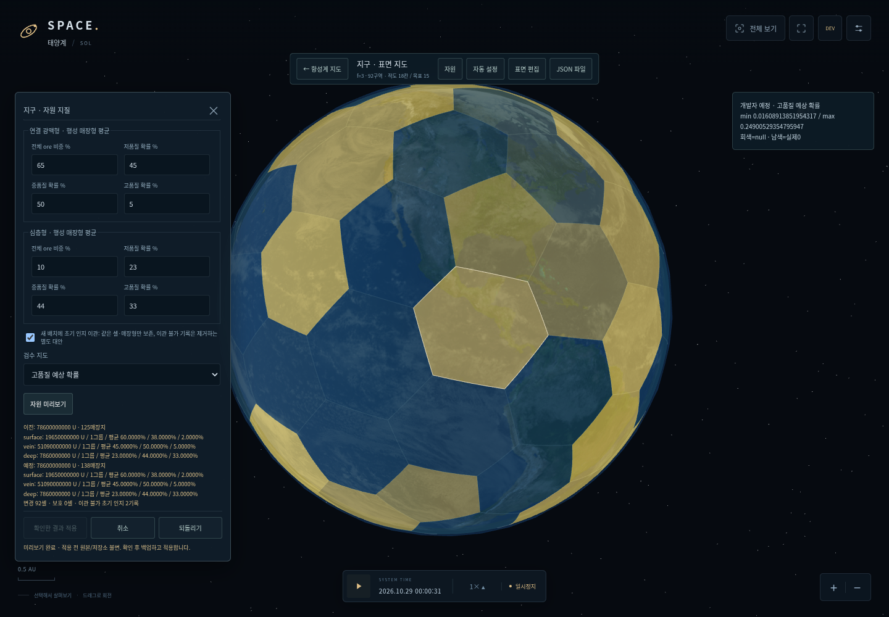
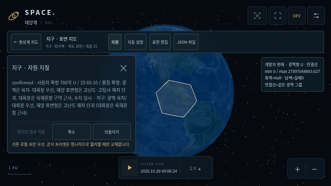

# v0.5D 검증 기록

2026-10-31 (Asia/Seoul). [완료 보고·확정/잠정값·소유권](REVIEW.md), [사용자 지구 원본](sources/EARTH_SOURCE.md), [19개 수치/시드](preset-report.json).

## 자동 검사

- `npm run check`: **42개 소스 모듈** 문법 검사.
- `npm test`: **122개 통과, 실패/건너뜀0**. 기존99개를 유지하고 자원 계약23개를 추가했습니다.
- `node scripts/generate-sol-presets.mjs`: 원본 SHA 확인 →19개 v2 생성 → 각 파일 schema/대상/격자/자원/그룹/품질/참조 검증 → 실제 manifest 기록.
- `git diff --check`, 패키저 Python 문법과 브라우저 테스트 스크립트 문법 검사.

새 검사는 지구/금성/화성/달의 정확한 총량·형태별 U, 지구/금성 품질 가중평균·기대 합금수율, 동일 유형 안의 실제 개별 확률 편차, 0/100%와 불균등 가중치, 달 표면100/저80·화성 잠정 상대 품질, **지구 육지/대륙붕 광맥과 해저단괴 난도**, 실제 구면 광맥 연결, 같은 seed의 JSON해시·시각/random 비의존, 여러seed의 고정 예산/평균 보존, 랜덤24seed의 총량/평균 차별성, null/0·invalid 입력, 큰 배치 O(1) 질량/재현성/일련번호 차이, 합금14/33/52와 기술 입력 분리, 지구 SHA/모든 시나리오/terrain/env 보존, 단일 셀 식민지, manifest19/전역ID/H공급원/아스트로지늄 금지, v1→v2 왕복, known-only 조회/티어 보존, 로컬v1 우선/백업/Undo, 미리보기 원자성/인지 이관, 잘못된 참조/비유한수 거부, 큰 값의 십진quanta, 수동 대안 평균과 시나리오 전용 편집의 설정 보존을 확인합니다.

기존 격자·기본 데이터·천문 자료·게임 AU/크기·모델·시간 제어·210 AU 섹터 파일은 변경하지 않았습니다. 자원 로직은 세계 시계를 전혀 진행시키지 않습니다.

## 브라우저와 캡처

Chromium/Playwright, SwiftShader. PC1440×1000, 실제 터치 이벤트를 사용하는844×390/667×375 에뮬레이션입니다. 아래 로그에는 각 스크립트의 최종 PASS와 page/console error 검사가 들어 있습니다.

| 로그 | 범위 |
|---|---|
| [browser-smoke.log](browser-smoke.log) | 기존 천체 선택·가림·정보 탭·카메라/궤도·크기/텍스처·210AU·두 모바일/fixture |
| [browser-administration.log](browser-administration.log) | 행정 생성/연결/Undo/저장/복원·실제0.1/1/100× 시계·두 모바일 |
| [browser-surface.log](browser-surface.log) | 19개 기존 표면/오각형 선택·spin고정·v1편집/파일·PC/모바일 fullscreen·Esc·미지원/거부/iframe |
| [browser-generation.log](browser-generation.log) | 기존 v0.5C 자연/POP/예산·색지도·수동0/1명/[]보존·JSON/sidecar/reload·100×·취소/정리 |
| [browser-safety.log](browser-safety.log) | 복수선택 잔여 예산·교체 파일/로컬 백업·stale preview/worker 취소·quota 메모리 경로 |
| [browser-resources.log](browser-resources.log) | 실제 공식19로드, 일반모드 known-only, 지구 새정책/7지도/geometry, 고정 예산·개별 확률, preview불변/백업/적용/Undo, 잘못된 확률 거부, v1원본 실제import→이관→v2export/import/reload, 지구·금성·화성·달·목성·유로파, 랜덤 총량 차이, cancellation/dispose/개발자DOM정리, 두 모바일6천체/파일/전체화면 |

v0.5B/v0.5C 세 편집 브라우저 스크립트의 **초기 상태만** 빈manifest의 미설정v1 fixture로 명시했습니다. 이 스크립트들은 '미설정 템플릿에서 시작하는' 기존 단언과 모든 동작 검사를 유지합니다. v0.5D 공식 프리셋으로 기본 상태가 바뀐 부분을 테스트 setup에서 분리한 것이며 production manifest는19개입니다. 새 browser-resources는 manifest를 가로채지 않고 실제19개 파일/로더와 v1기존 로컬 우선 동작을 확인합니다. 로고7회 테스트는 좌표를 한 번 읽고 실제 click/tap7회를 보내며 제품의5초 제한은 바꾸지 않았습니다.

기존 Google Fonts가 간헐적으로 CORS 오류를 내는 것을 확인해 외부 폰트 import를 제거했습니다. 모든 브라우저 자산은 로컬에서 읽고 시스템 폰트를 사용합니다. 폰트 오류를 무시하도록 error 단언을 완화하지 않았습니다.

### PC

[지구 표면·해저단괴](screenshots/earth-surface-nodules.png) · [지구 연결 광맥](screenshots/earth-veins.png) · [품질 지도](screenshots/earth-quality.png) · [현재/예정 비교](screenshots/earth-resource-preview.png) · [금성](screenshots/venus-resource.png) · [화성](screenshots/mars-resource.png) · [달](screenshots/moon-resource.png) · [목성](screenshots/jupiter-resource.png) · [유로파](screenshots/europa-resource.png) · [랜덤 시험계](screenshots/random-resource.png).

### 모바일

- 844×390: [지구](screenshots/mobile-844-earth.png), [금성](screenshots/mobile-844-venus.png), [화성](screenshots/mobile-844-mars.png), [달](screenshots/mobile-844-moon.png), [목성](screenshots/mobile-844-jupiter.png), [유로파](screenshots/mobile-844-europa.png).
- 667×375: [지구](screenshots/mobile-667-earth.png), [금성](screenshots/mobile-667-venus.png), [화성](screenshots/mobile-667-mars.png), [달](screenshots/mobile-667-moon.png), [목성](screenshots/mobile-667-jupiter.png), [유로파](screenshots/mobile-667-europa.png).





좁은 화면은 폼과 긴 설명/JSON을 내부 스크롤합니다. footer확인/취소/Undo는 하단 HUD 위에 유지하고 전체화면 버튼에 접근합니다. 실제 iPhone/Safari/Firefox·기기 GPU·OS 파일선택기 자체는 미검증입니다. Chromium의 표준 파일 입력/다운로드와 네이티브 Fullscreen은 실제 동작을 확인했습니다.

## 성능·한계

정수 배분은 광석 quanta 수와 무관하게 셀/매장지 수에 비례하고, 실제 생성/평균 검증은 Worker에서 수행합니다. 한 천체의 기존 색상 Mesh1개와 필요 시 광맥 연결 LineSegments1개를 사용합니다. 반복 모드/미리보기/취소 후 geometry가 기준 수준으로 돌아오고 canvas/편집기는1개입니다. 소프트웨어 렌더링의 기존 전체 지도 표본은 약4.3FPS였으며 동시 검사 부하를 포함하므로 모바일 기기 성능이나60FPS를 보장하지 않습니다.

지구 대륙붕은 육해혼합 광역 구역의 근사이며 실제 수심 검증이 아닙니다. 기본 품질 double평균 허용오차1e-6(테스트1e-10), 배치 대량 추첨은 bounded normal approximation입니다. 매우 희귀한 꼬리 분포의 정밀 이항 시뮬레이터는 미구현입니다. 실제 생산/고갈/경제/테라포밍/함선/연구를 실행하지 않습니다. 미래 잔량/재고/현재 기후는 원본과 분리합니다.

## 재현과 패키지

```sh
npm run dev
node scripts/generate-sol-presets.mjs
npm run check
npm test
PLAYWRIGHT_MODULE=/path/to/playwright-core/index.mjs CHROMIUM_EXECUTABLE=/path/to/chromium node tests/browser-smoke.mjs
PLAYWRIGHT_MODULE=/path/to/playwright-core/index.mjs CHROMIUM_EXECUTABLE=/path/to/chromium node tests/browser-administration.mjs
PLAYWRIGHT_MODULE=/path/to/playwright-core/index.mjs CHROMIUM_EXECUTABLE=/path/to/chromium node tests/browser-planet-surface.mjs
PLAYWRIGHT_MODULE=/path/to/playwright-core/index.mjs CHROMIUM_EXECUTABLE=/path/to/chromium node tests/browser-planet-generation.mjs
PLAYWRIGHT_MODULE=/path/to/playwright-core/index.mjs CHROMIUM_EXECUTABLE=/path/to/chromium node tests/browser-generation-safety.mjs
PLAYWRIGHT_MODULE=/path/to/playwright-core/index.mjs CHROMIUM_EXECUTABLE=/path/to/chromium node tests/browser-resources.mjs
python3 scripts/package-release.py
```

HTML ZIP에는 42모듈/두 자원·환경 Worker/19개v2와manifest/사용자v1원본/지구마스크/Three.js/표면이미지/라이선스/serve.py/SOURCE.json이 들어갑니다. 압축 해제 후 `python3 serve.py` (Windows `py serve.py`)、file:// 직접 실행은 지원하지 않습니다. 최종 ZIP의 CRC/소스 SHA/독립 서버에서 공식 로드와 Worker 미리보기를 별도로 검증합니다.
